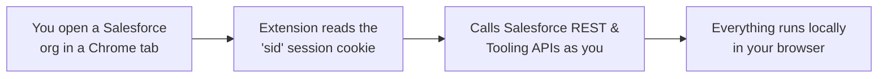
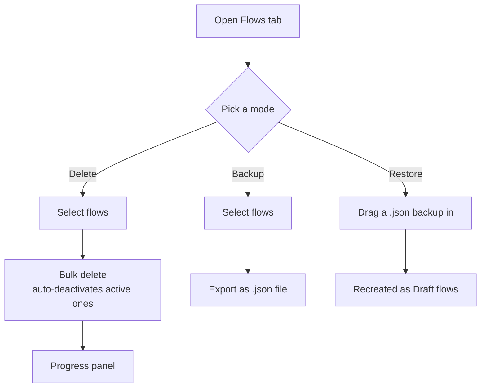
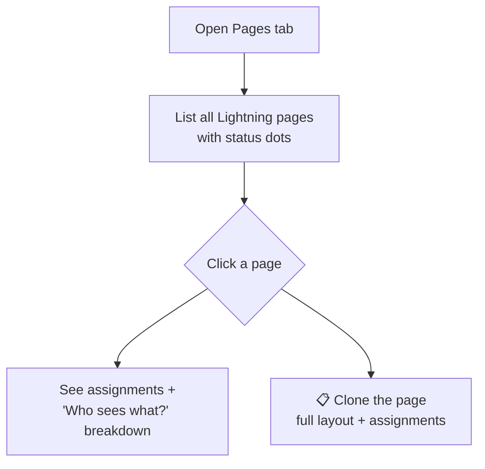
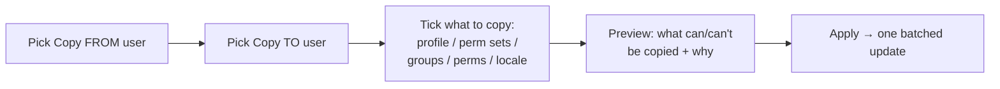
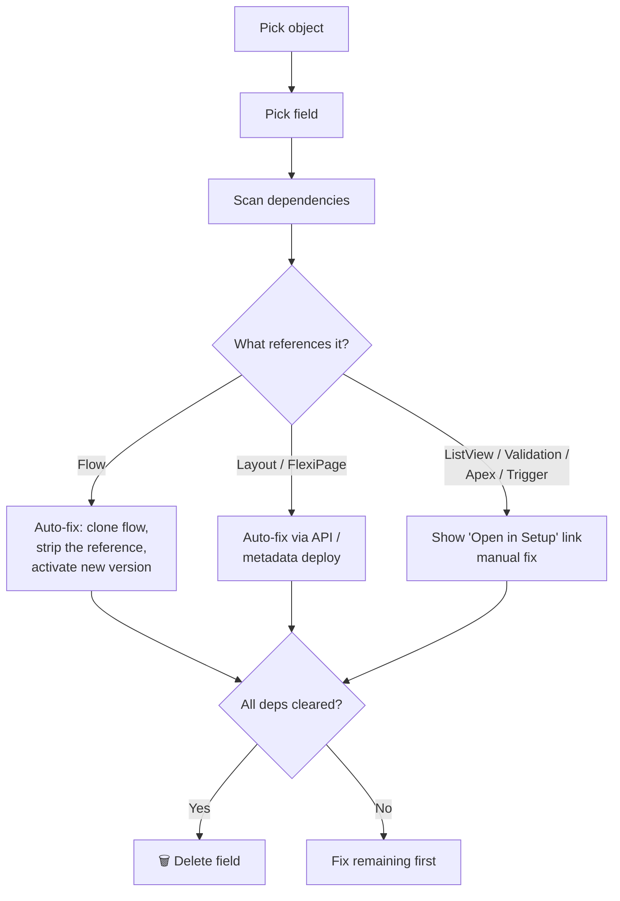
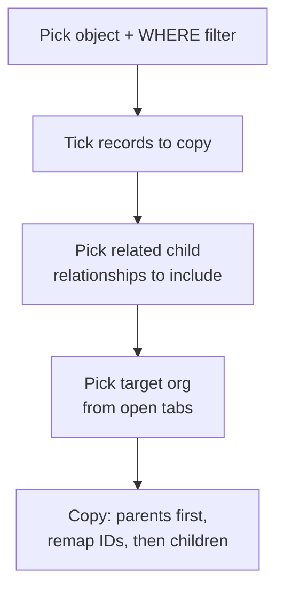
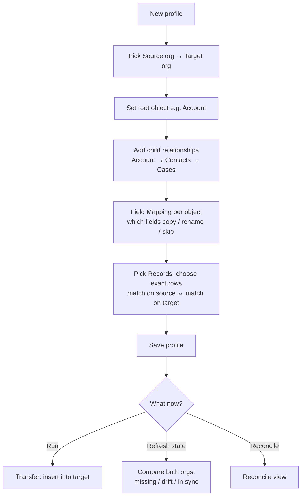
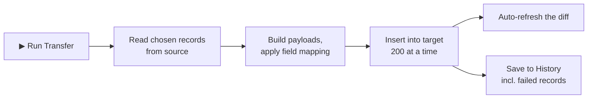
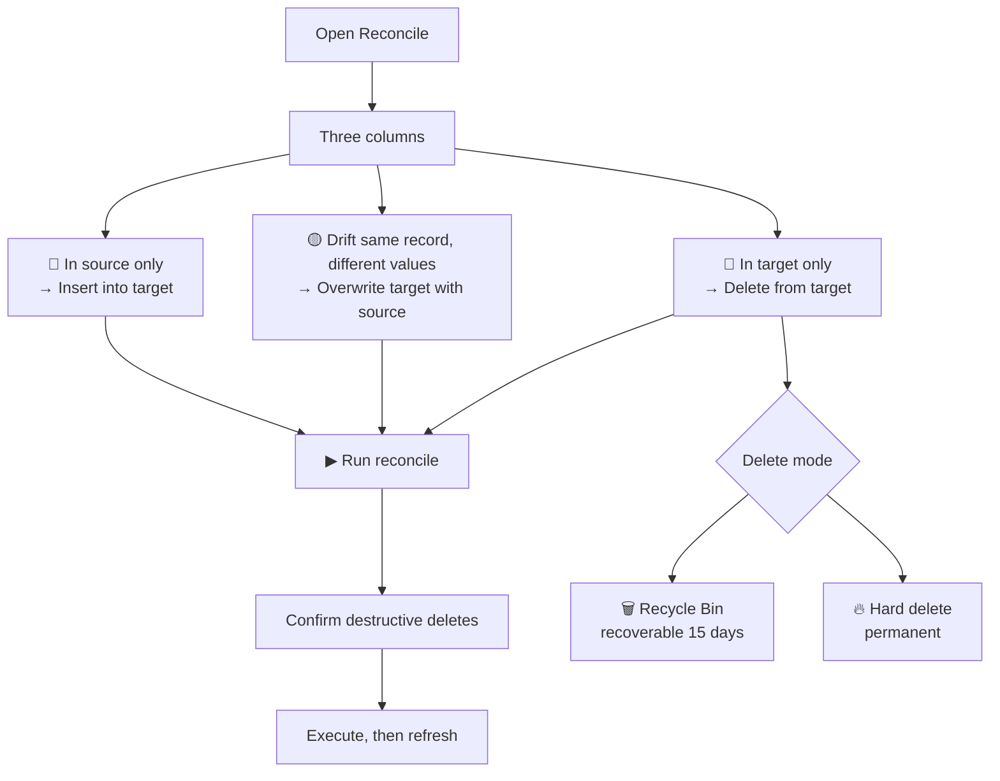

# Salesforce Toolkit — Design & User Guide

> A plain-language guide to everything the extension does, how to use each feature, and how the pieces fit together. Written so a Salesforce admin (not a developer) can follow it.

---

## 1. The big picture

The extension is **two apps in one**:

| App | Where it lives | What it's for |
|---|---|---|
| **The Toolkit** | The popup / toolbar window | Day-to-day admin chores inside **one** org: clean up flows, fields, pages, users, licenses. |
| **Data Studio** | A full browser tab (click 🌐 Data) | Moving and comparing data **between** orgs: copy records, deploy profiles, reconcile differences. |

### How it logs in (no passwords)

There is **no login screen, no connected app, no stored password.** The extension reuses the Salesforce session you already have open in Chrome. If an org isn't open in a tab, the extension can't reach it.

---

## 2. The Toolkit (popup)

Open it from the toolbar icon. It detects your current org automatically and shows a home screen of feature cards. Tabs: **Flows · Dependencies · Conflicts · Pages · Users · Fields · Copy**, plus the **Apex Debugger**.

### 2.1 Flows

Manage Salesforce Flows in bulk. Three modes:

- **Delete** — tick the flows you want gone, hit delete. Active flows are deactivated first automatically.
- **Backup** — export selected flows to a JSON file you keep on your computer.
- **Restore** — drop a backup file back in to recreate those flows as drafts.
- **Subflow dependency scan** — before deleting, see which flows call which subflows so you don't break a chain.

### 2.2 Dependencies (🗺)

Shows a tree of which flows call which subflows — a map of how your automation is wired together.

### 2.3 Conflicts (⚡)

Scans for conflicting flow definitions across the org (e.g. two flows fighting over the same trigger).

### 2.4 Pages (📄)

Lightning page management.

- Status dots: green = active, grey = draft, red = obsolete.
- The org-default page is detected automatically.
- **Clone** rebuilds a page (layout + who-sees-it rules) in one click.

### 2.5 Users (👥)

Three sub-tabs:

- **Copy Permissions** — copy settings from one user to another. You pick a *Copy FROM* user and a *Copy TO* user, then choose what to carry over:
  - 👤 Profile (warns if licenses are incompatible)
  - 🔑 Permission Sets
  - 👥 Public Groups
  - 🛡️ User Permissions (Marketing User, Flow User, etc.)
  - ⚙️ Locale & Timezone
- **Licenses** — view all org licenses and their counts; change a user's license.
- **Flow Access** — see which users/profiles can run a given flow.

### 2.6 Fields (🔧) — Field Cleaner

Safely delete a custom field — but only after cleaning up everything that references it.

The cleaner finds every flow, layout, page, list view, validation rule, Apex class, and trigger that uses the field. Flows, layouts, and pages get an automatic fix; the rest get a "fix it in Setup" link. Once everything's clear, the Delete button unlocks.

### 2.7 Copy (📋) — Record Copy

Copy specific records (and their related children) from one org to another.

IDs differ between orgs, so the tool builds an ID map: it inserts the parents, learns their new IDs, then rewrites the children's lookups to point at the new parents.

### 2.8 Apex Debugger

Captures Apex logs for a user, parses them, and shows what ran: SOQL count, DML, flows triggered, exceptions, and the raw log with search.

---

## 3. Data Studio (full tab)

Open with the 🌐 **Data** button. Sidebar: **Connected Orgs · Data Deployment · History · Deploy Readiness · Schema View**.

> Data Studio works only with orgs you have **open in Chrome tabs**. There's no credential login.

### 3.1 Connected Orgs (home)

Lists every Salesforce org detected in your open tabs. Green dot = open now, grey = seen before but not open. From here you can rename an org or jump into a transfer. Click **🔄 Refresh from open tabs** after opening a new org.

### 3.2 Data Deployment — the core flow

This is where you define **profiles** (reusable copy configurations) and run them. A profile = "which records, from which org, to which org, mapped how."

**Key ideas in plain words:**

- **Profile** — a saved recipe for a copy. Reuse it any time.
- **Object tree** — start from one object (Account) and pull its related records (Contacts, Cases) along with it, up to a few levels deep.
- **Field Mapping** — for each object, decide which fields get copied, which get renamed (source `Email` → target `Email2__c`), and which get skipped.
- **Match field** — the field that identifies "the same record" across two orgs (Salesforce IDs differ between orgs, so you match on something stable like Name or an External Id). You can pick a **different field on each side**.
- **Compare fields** — taken from your Field Mapping; differences in these mark a record as "drifted."

#### Transfer (the write)

Inserts records into the target org. The source is never changed. After it runs, the diff refreshes so you can see the new state, and the run is logged in History (including which records failed).

#### Reconcile — the 3-way diff

The most powerful view. After **🔄 Refresh state** compares the two orgs, Reconcile shows three columns and lets you fix everything in one screen:

- 🔴 **In source only** → push (insert) into target.
- 🟡 **Drift** → the same record exists in both but values differ; overwrite the target with the source values. Click **▸ fields** on any drift row to see exactly which fields differ, side by side.
- 🔵 **In target only** → extras you can delete (Recycle Bin or permanent hard delete).

Tick what you want in each column, pick a delete mode, hit **▶ Run reconcile**. Deletes always ask for confirmation.

### 3.3 History

Every transfer and reconcile run, newest first: status, org pair, per-object counts, and errors. If a run had failures, a **↻ Retry failed** button re-runs only the records that failed.

### 3.4 Deploy Readiness

Before you copy data, check the two orgs' **schemas** are compatible — missing fields, picklist gaps, validation rules that would block a load. Read-only.

### 3.5 Schema View

A visual graph of how objects relate and which flows run on them. Read-only.

---

## 4. Cross-cutting concepts

### Diff states (used by Pick Records, profile cards, and Reconcile)

| Badge | Meaning | What to do |
|---|---|---|
| 🟢 In sync | Same record, same values | Nothing |
| 🟡 Drift | Same record, different values | Overwrite (or leave) |
| 🔴 Missing in target | In source, not in target | Insert |
| 🔵 In target only | In target, not in source | Delete (or leave) |

### Where data is stored

Everything is local to your browser (`chrome.storage.local`): saved profiles, run history, org labels. Nothing is uploaded anywhere — no server, no telemetry.

### Safety model

- Reads are free and reversible.
- Writes (Transfer, Reconcile) only happen when you explicitly click Run, against the target org you chose.
- Deletes always confirm; hard delete warns it's permanent.
